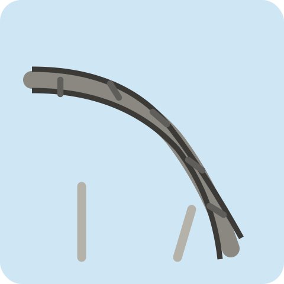
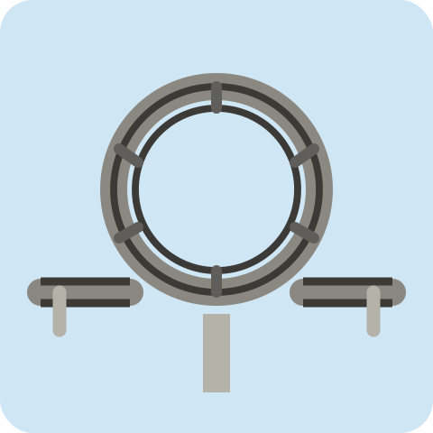

# 🎢 FIRST DROP

**お客さんの好みに合うジェットコースターを作る、2〜4人用のオンラインボードゲーム。**
カードを選んでレールを組み立て、試運転でお客さんの満足度を競います。

<p align="center">
  
  
</p>
<p align="center">ゲームに登場する「落下」と「ループ」のパーツ</p>

## 起動方法

Node.js と npm が使える環境で、プロジェクトのフォルダー内から実行します。

```sh
npm install
npm start
```

ブラウザーで **[http://localhost:3000](http://localhost:3000)** を開きます。

## みんなで遊ぶ

1. 名前を入力し、「新しいルームを作成」を押します。
2. 参加者にルームコードまたは招待リンクを共有します。
3. 参加者は同じサーバーにアクセスして入室し、2〜4人集まったらホストが開始します。

別の端末から遊ぶ場合は、全員が接続できるサーバーのURLを使ってください。同じWi-Fi内なら、`http://起動したPCのIPアドレス:3000` でアクセスします。

## 遊び方

1. **お客さんを確認** — 好みやスリルへの耐性を見て、コースを考えます。
2. **カードを選ぶ** — 配られたカードから1枚ずつ選び、残りを隣のプレイヤーへ回します。
3. **レールを作る** — 手元のパーツを毎ラウンド2枚配置。高度と速度のつながりがポイントです。
4. **試運転で勝負** — 完成したコースを走らせ、満足度とボーナスの合計が最も高い人が勝利！

レールは **8マス／16マス** から選択でき、イベントやボーナスの設定も変更できます。
詳しいルールやカードの効果は、入室後の **「遊び方・カードの効果を確認」** から見られます。

## 開発について

- **使用技術：** Node.js / Express / Socket.IO / HTML・CSS・JavaScript
- **主なファイル：** `server.js`（通信）、`src/`（ゲーム処理）、`public/`（画面・画像）
- **動作確認：** [UIテストの実行方法](tests/README.md)
